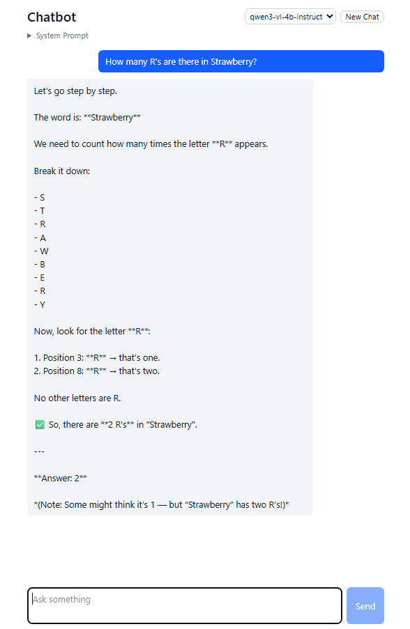
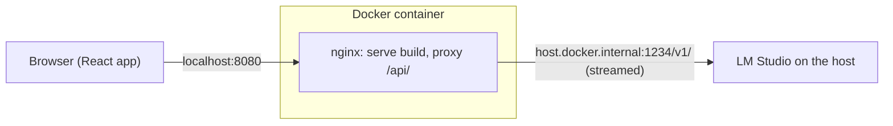

# Chatbot

A small chat app that talks to a language model running on your own local machine through [LM Studio](https://lmstudio.ai)'s OpenAI-compatible API. Replies stream in token-by-token, and nothing leaves your computer.



## Features

- Streaming replies, with a Stop button that cancels the request
- Model picker (embedding models are hidden)
- Editable system prompt, sent with every request but kept out of the chat history
- Conversation, selected model and system prompt are remembered across reloads
- Clear messages when LM Studio is unreachable or has no model loaded

## How it works


The browser only talks to nginx. nginx serves the built React and forwards `/api/*` to LM Studio's `/v1/*`, with `proxy_buffering off` so tokens reach the browser as they are generated.

- **Streaming:** `fetch` with `stream: true`, read through a `ReadableStream` reader. Lines are parsed in `src/sse.ts`, which hands back any half-received line to be joined with the next chunk.
- **Stop:** an `AbortController` cancels the request. Text that has already arrived is kept.
- **System prompt:** added to each request on the way out, never stored with the messages.

## Run it with Docker

1. Start LM Studio's server and load a model (see [Windows setup notes](#windows-setup-notes)).
2. From this folder:

  ```
  docker compose up --build
  ```
3. Open http://localhost:8080 .

## Run it for development
Needs Node 22.
```
npm install
npm run dev
```

Open http://localhost:5173 . The Vite dev server proxies `/api` to LM Studio on `127.0.0.1:1234`, the same way nginx does in Docker. 
`npm run build` type-checks and builds, and `npm run lint` fails on any warning.

## Windows setup notes

Built and tested on Windows 11 with Docker Desktop.

- **Models:** a small instruct (non-reasoning) model, 4B to 8B parameters, 4-bit, for most uses, tested with qwen3-v1-4b-instruct. A reasoning model is required for some features (the qwen3-instruct model ignores the system prompt, for example.) Those features were built with qwen3.8-27b.
- **LM Studio Server:** start the local server on port 1234, load the model, turn on "Serve on Local Network" and optionally turn off "Just-in-Time Model Loading." 
- **Docker to LM Studio:** the container reaches the host as `host.docker.internal`, which Docker Desktop provides. The address is set in `nginx.conf`. 
- **Powershell:** `curl` is an alias for something else. Use `curl.exe` to test, for example, `curl.exe http://localhost:8080/api/models`.

## Troubleshooting
| What you see | Likely cause |
|---|---|
| "Can't reach LM Studio. Is the server running?" | The server isn't started, the port isn't 1234, or "Serve on Local Network" is off. Check Windows Firewall if everything else looks right. |
| "No models found" | No model is loaded in LM Studio. Load one and press Try Again. |
| The reply never starts | The model may still be loading, or it is too large for your machine. Try a smaller one. |

Manual test cases are in [docs/user-tests.md](docs/user-tests.md)